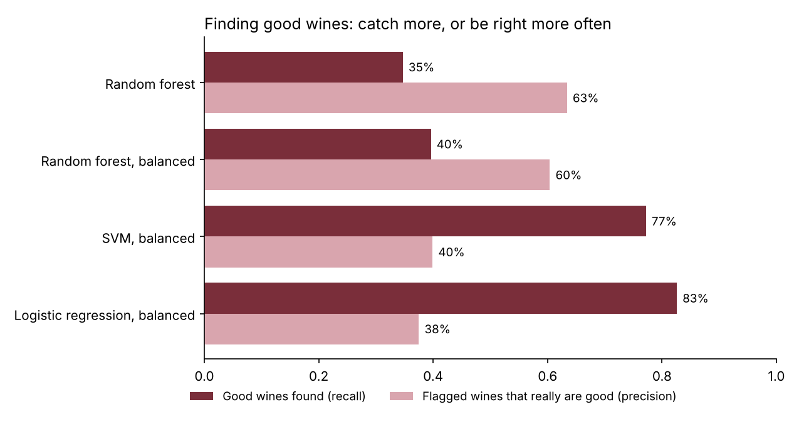
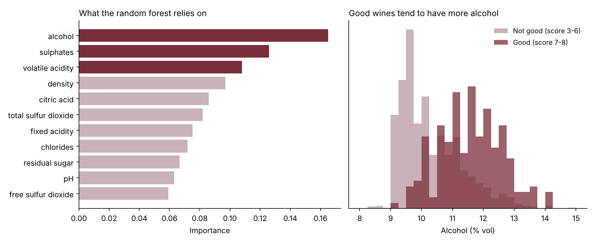

# Red Wine Quality: Finding the Good Bottles


Can a wine's lab measurements (acidity, sugar, sulphates, alcohol and so on) predict whether tasters will rate it highly? The data covers 1,599 Portuguese red wines, each scored from 0 to 10 by tasters. A wine counts as **good** if it scored 7 or more. Only about 1 in 7 do.

My [first version](notebooks/01_original_notebook.ipynb) reached **89.7% accuracy** with a tuned SVM. Revisiting it, I found two reasons that number looked better than it was.

## Problem 1: the same wines were in training and test

The dataset contains **240 exact duplicate rows**. With a random split, **64 of the 320 test wines also appeared in the training data**, so the model was partly marked on wines it had already seen.

| Test wines | Random forest accuracy |
|---|---|
| Repeated from training (64) | **100%** |
| Genuinely new (256) | 87.5% |

All results below use the 1,359 unique wines, with 5-fold stratified cross-validation. Each wine is tested exactly once, by a model that never saw it.

## Problem 2: high accuracy, few good wines found

Because 86% of wines aren't good, a "model" that always says *not good* is already 86.5% accurate. The original models looked strong on accuracy but found only about a third of the good wines.

| Model | Accuracy | Good wines found | Flagged wines that really are good | ROC AUC |
|---|---|---|---|---|
| Always "not good" | 86.5% | 0% | n/a | 0.50 |
| Random forest | 88.3% | 35% | 63% | 0.875 |
| Random forest, balanced | 88.1% | 40% | 60% | **0.883** |
| SVM, balanced | 80.9% | 77% | 40% | 0.874 |
| Logistic regression, balanced | 78.6% | **83%** | 38% | 0.875 |



**What this shows:**
- **"Balanced" models**, which give the rare good wines more weight during training, find more than twice as many good wines (83% vs 35%). The cost is more false alarms.
- **All the models rank wines about equally well** (ROC AUC around 0.88). The real choice is where to draw the line, and that depends on the use. A buyer screening wines to taste would want the high-recall model, so they don't miss good ones. A shop labelling bottles "premium" would want the high-precision one.
- **Simple logistic regression is as good as the more complex models** here, and it's easier to explain.

## What makes a wine good?



**Alcohol** is the strongest signal. Good wines average 11.6% against 10.3% for the rest. Higher **sulphates** and lower **volatile acidity** (the vinegary taste) come next. All three match what winemakers would expect.

## Other fixes from the first version

- **Scaling the test set separately.** The original scaled the test data using its own averages (`fit_transform` on the test set), so training and test were measured on different scales. Scaling now happens inside each cross-validation fold, fitted on training data only.
- **Judging on one number.** Recall, precision, F1 and ROC AUC are reported alongside accuracy, compared against an "always not good" baseline.

## Run it yourself

```bash
git clone https://github.com/ranzith1282000-beep/wine-quality-classification.git
cd wine-quality-classification
pip install -r requirements.txt
python src/wine.py   # writes results/ and the charts in images/
pytest               # 4 tests
```

## Repository layout

```
├── src/wine.py                           leakage check, evaluation and charts
├── tests/test_wine.py
├── data/winequality-red.csv              1,599 wines
├── results/                              results.csv and leakage_check.json
├── images/
└── notebooks/01_original_notebook.ipynb  my first version
```

## Tools

Python, pandas, scikit-learn, Matplotlib, pytest, GitHub Actions

Data: the Wine Quality dataset from the UCI Machine Learning Repository (Cortez et al., 2009).
